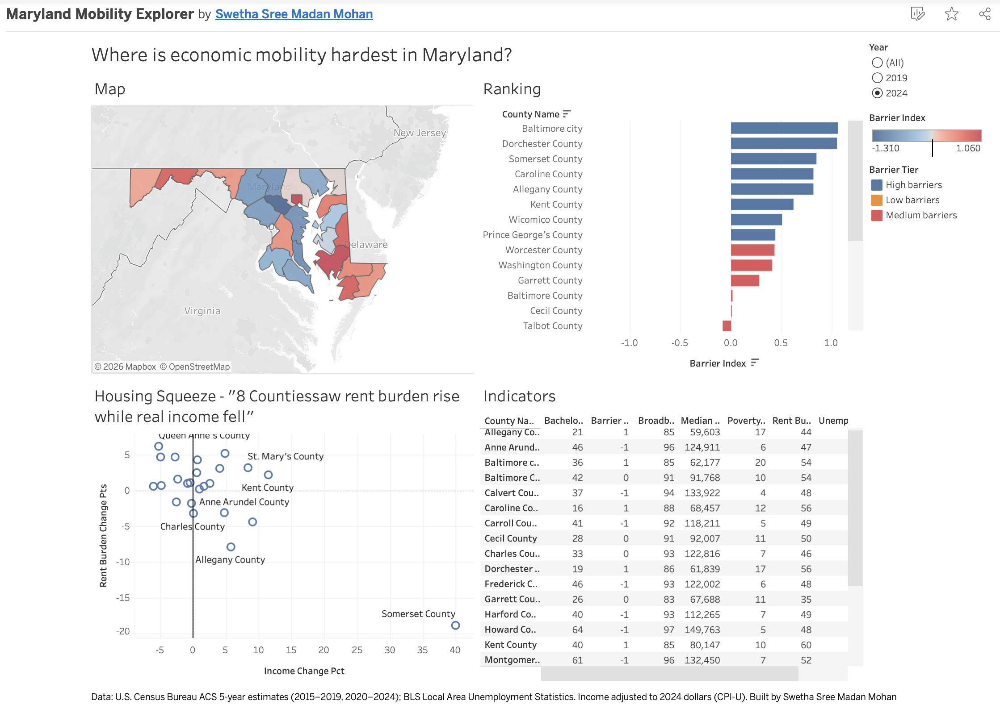
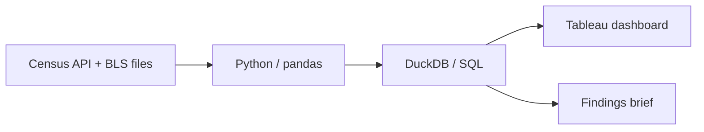

# Maryland Mobility Explorer

How hard is it to get ahead depending on where you live in Maryland? I wanted a real answer to that, so I built this project using public Census and BLS data for all 24 jurisdictions (23 counties plus Baltimore City), comparing 2015–2019 with 2020–2024.

**[Interactive dashboard on Tableau Public](https://public.tableau.com/views/MarylandMobilityExplorer/MarylandMobilityExplorer)** · **[One-page findings brief](docs/findings_brief.pdf)**



## What I found

- **Rent burdens are heaviest on the Eastern Shore.** All five jurisdictions where the largest share of renters spend 30%+ of their income on rent are on the Shore. Kent County is highest at 59.6%.
- **Barriers cluster in Baltimore City, the Eastern Shore, and Western Maryland.** Baltimore City and Dorchester County score highest on the Mobility Barriers Index. Howard County scores lowest.
- **In 8 counties, real income fell while rent burden rose.** Queen Anne's had the sharpest squeeze (income down 5.2%, rent burden up 6.2 points), followed by Caroline and Baltimore County.
- **Broadband access and poverty move together.** Counties with lower broadband subscription rates have higher poverty (r = −0.77).

## Questions I set out to answer

1. Which counties have the highest rent burden relative to income?
2. Where did income keep up with housing costs, and where didn't it?
3. If you combine several indicators, how do counties rank overall?
4. Do broadband access and education line up with poverty?

## How it's built



| Step | Tools | Where |
|---|---|---|
| Pull ACS data from the Census API | Python, requests | `notebooks/01_pull_data.ipynb` |
| Clean data, calculate rates, adjust income for inflation, join BLS unemployment | pandas | `notebooks/02_clean_data.ipynb` |
| Load into a local database | DuckDB | `notebooks/03_load_duckdb.ipynb` |
| Change over time, rankings, and the barriers index | SQL (self-join, window functions, CTEs) | `sql/`, `notebooks/04_sql_analysis.ipynb` |
| Dashboard | Tableau Public | [link](https://public.tableau.com/views/MarylandMobilityExplorer/MarylandMobilityExplorer) |

## Data

| Indicator | Source |
|---|---|
| Median household income (2024 dollars) | ACS 5-year, B19013 |
| Poverty rate | ACS 5-year, B17001 |
| Rent burden (renters paying 30%+ of income) | ACS 5-year, B25070 |
| Bachelor's degree or higher, age 25+ | ACS 5-year, B15003 |
| Households with broadband | ACS 5-year, B28002 |
| Uninsured rate | ACS 5-year, S2701 |
| Unemployment rate | BLS Local Area Unemployment Statistics |

## Method notes

- I compared the 2015–2019 and 2020–2024 ACS 5-year releases because they don't overlap, which is what the Census Bureau recommends for change over time.
- 2019 incomes are converted to 2024 dollars using the CPI-U annual averages (255.657 and 313.689).
- The **Mobility Barriers Index** turns each indicator into a z-score within its period. I flipped the sign on income, education, and broadband so that a higher score always means more barriers, then took the average of all seven. Counties are ranked and split into three tiers of eight.
- As a sanity check, the index averages 0 in both periods, which is what you'd expect from z-scores.

## Caveats

- ACS numbers are survey estimates. Small counties like Somerset and Kent have wide margins of error. Somerset's swings (income up 40%, rent burden down about 19 points) are almost certainly noise, so I don't treat them as findings.
- Several of the 8 "squeezed" counties, including Montgomery and Carroll, changed by only a point or so, which may be within the margin of error.
- 2020–2024 includes the pandemic years.
- The index weights everything equally and only compares Maryland counties with each other.
- The correlations come from 24 data points. They describe a pattern, not a cause.

## Running it yourself

```bash
git clone https://github.com/swethasreemadan-2709/maryland-mobility-explorer.git
cd maryland-mobility-explorer
python3 -m venv .venv
source .venv/bin/activate
pip install -r requirements.txt
```

1. Get a free Census API key at [api.census.gov/data/key_signup.html](https://api.census.gov/data/key_signup.html) and activate it from the email.
2. Create a `.env` file in the project folder with `CENSUS_API_KEY=your_key`.
3. Download `laucnty19.xlsx` and `laucnty24.xlsx` from [bls.gov/lau/tables.htm](https://www.bls.gov/lau/tables.htm) into `data/raw/`.
4. Run the notebooks in order, 01 through 04.

## What I'd do next

- Bring in the ACS margins of error and flag changes that aren't statistically significant
- Try different index weights and see how much the rankings move
- Go down to census tracts to see differences within counties

## About

Built by Swetha Sree Madan · [LinkedIn](https://www.linkedin.com/in/swetha-sree-madan-mohan2709)

This is a personal project using only public data. It isn't affiliated with or endorsed by any Maryland state agency.
